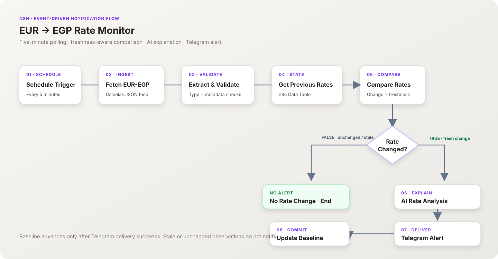

<div align="center">

# EUR → EGP Rate Monitor

### A change-aware FX monitoring workflow with AI-assisted summaries and Telegram alerts

<p>
  <a href="https://n8n.io/"></a>
  <a href="https://getdaleelak.com/en/api"></a>
  <a href="https://openrouter.ai/"></a>
  <a href="https://core.telegram.org/bots/api"></a>
</p>
<p>
  
  
  
  
  <a href="LICENSE"></a>
</p>

**Created by [Sohila Khaled Abbas](https://github.com/Sohila-Khaled-Abbas)** · BI Developer · Data Analyst · Analytics Engineer

</div>

---

## Project snapshot

This project monitors the **EUR/EGP exchange-rate pair** using the public Daleelak feed. It validates and normalizes the latest bank rates, compares them with a stored baseline, checks source freshness, and sends a Telegram alert only when a fresh rate change is detected. An AI step adds a short plain-English interpretation before delivery.

The workflow is designed to demonstrate practical automation patterns: API ingestion, data validation, state management, conditional execution, LLM-assisted explanation, notification delivery, and post-delivery state updates.

> [!IMPORTANT]
> The rates are **indicative reference data**, not guaranteed executable bank quotes or financial advice. Confirm any transaction rate directly with the relevant bank. The workflow does not execute trades or financial transactions.

## Architecture

<div align="center">
  
</div>

### Execution path

| Stage | n8n node | Responsibility |
|---|---|---|
| 01 · Schedule | `Schedule Trigger` | Starts the workflow every five minutes using `Africa/Cairo`. |
| 02 · Ingest | `Fetch EUR-EGP Rate` | Requests the EUR asset feed from Daleelak. |
| 03 · Validate | `Extract & Validate EUR-EGP` | Finds the EUR-EGP asset, validates the two directional rates and observation metadata, and emits a normalized record. |
| 04 · State read | `Get Previous EUR-EGP Rates` | Retrieves the saved EUR-EGP baseline from an n8n Data Table. |
| 05 · Compare | `Compare EUR-EGP Rates` | Calculates rounded changes and determines whether the feed is fresh and the rates changed. |
| 06 · Route | `Rate Changed?` | Sends only fresh changes down the TRUE branch; unchanged or stale observations end quietly. |
| 07 · Explain | `Generate AI Rate Analysis` + `OpenRouter Chat Model` | Generates a short, constrained explanation using the validated comparison context. |
| 08 · Notify | `Send EUR-EGP Telegram Alert` | Delivers both directional rates, previous values, changes, the AI summary and source attribution. |
| 09 · Commit state | `Update EUR-EGP Baseline` | Updates the baseline only after the Telegram notification node succeeds. |

The FALSE branch terminates at `No Rate Change - End`. It does not send a message or update the baseline.

## Why the state update happens after Telegram

The order is intentional:

1. A fresh change is detected against the last successfully notified baseline.
2. The AI analysis is generated.
3. Telegram sends the notification.
4. Only after successful delivery does the Data Table baseline advance.

This avoids marking a change as processed before its alert has been delivered. A second run with unchanged values follows the FALSE branch, preventing repeated notifications for the same baseline.

## Technology stack

| Layer | Technology | Use |
|---|---|---|
| Orchestration | **n8n** (self-hosted) | Scheduled workflow, node orchestration and branching |
| Source | **Daleelak public API** | Indicative EUR-EGP bank-rate feed |
| Validation | **JavaScript Code nodes** | Asset selection, required-field checks, normalization and rate comparison |
| State | **n8n Data Tables** | Stores the latest successfully notified rates |
| AI | **OpenRouter free model route** | Concise natural-language explanation |
| Delivery | **Telegram Bot API** | Rate-change notification |
| Runtime | **Africa/Cairo** timezone | Consistent schedule interpretation |

## Data model

The workflow normalizes the external response into a compact object before comparing it with stored state.

| Field | Meaning |
|---|---|
| `currencyPair` | Currency pair identifier (`EUR-EGP`) |
| `youSellEurRate` | EGP received per EUR when the customer sells EUR to a bank |
| `youSellEurBank` | Bank associated with the customer-sells-EUR rate |
| `youBuyEurRate` | EGP paid per EUR when the customer buys EUR from a bank |
| `youBuyEurBank` | Bank associated with the customer-buys-EUR rate |
| `officialBuyBenchmark`, `officialSellBenchmark` | Additional source benchmarks, when provided |
| `globalRate` | Global reference rate, when provided |
| `asOf`, `observedAt` | Source observation date and timestamp |
| `freshness`, `isStale`, `confidence`, `providers` | Source-quality metadata |

The persistent Data Table `EUR_EGP_Rate_State` contains one row keyed by `currencyPair`:

| Column | Type | Example key |
|---|---|---|
| `currencyPair` | String | `EUR-EGP` |
| `youSellEurRate` | Number | Current observed customer-sells-EUR rate |
| `youBuyEurRate` | Number | Current observed customer-buys-EUR rate |

### Direction semantics

- **When you sell EUR:** the bank buys EUR from you. Use `youSellEurRate` and `youSellEurBank`.
- **When you buy EUR:** the bank sells EUR to you. Use `youBuyEurRate` and `youBuyEurBank`.

The AI prompt explicitly keeps these directions separate to prevent bank/rate interchange.

## Getting started

### Requirements

- A self-hosted n8n instance with **Data Tables** enabled.
- An OpenRouter account/API credential configured in n8n.
- A Telegram bot and the destination chat ID.
- Access to the public Daleelak EUR feed.

### 1. Import the workflow

1. Download [`workflows/eur-to-egp-rate-monitor.json`](workflows/eur-to-egp-rate-monitor.json).
2. In n8n, open **Workflows → Import from File** and select the JSON.
3. Keep the imported workflow **inactive** until setup and testing are complete.

The public template deliberately contains placeholders instead of the original workflow IDs, credential references, data-table IDs, and chat ID.

### 2. Create and seed the Data Table

Create a Data Table named `EUR_EGP_Rate_State` with these columns:

- `currencyPair` — String
- `youSellEurRate` — Number
- `youBuyEurRate` — Number

Insert exactly one initial row for `EUR-EGP`. Populate the two numeric values using a fresh execution of `Fetch EUR-EGP Rate` → `Extract & Validate EUR-EGP`. Do not seed the table with old sample values. The comparison node expects a valid baseline row to exist before the full workflow can run.

Then open both Data Table nodes and select the newly created `EUR_EGP_Rate_State` table. The exported IDs are placeholders and must be replaced by the table in your own n8n instance.

### 3. Configure credentials and Telegram destination

- **OpenRouter Chat Model:** select your OpenRouter credential. The exported node uses the `openrouter/free` route; model availability is controlled by the provider and can change.
- **Send EUR-EGP Telegram Alert:** select your Telegram credential and replace `REPLACE_WITH_TELEGRAM_CHAT_ID` with the destination chat ID.
- Keep API keys and Telegram tokens inside n8n Credentials. Do not paste them into workflow expressions or commit them to Git.

### 4. Check the schedule and activate

Confirm the Schedule Trigger is set to **every 5 minutes** and the workflow timezone is `Africa/Cairo`. The JSON template is preconfigured for this interval. Test both branches before activation:

- **TRUE branch:** temporarily use a deliberately different baseline, run once, and verify AI analysis → Telegram delivery → Data Table update. Restore the baseline to the latest actual API values immediately after the test.
- **FALSE branch:** run again without changing the source/baseline. Verify that `No Rate Change - End` runs and no Telegram alert or baseline update occurs.
- Confirm the AI response is non-empty and that the two customer directions and their banks are correctly labeled.

Activate the workflow only after the baseline is restored and the two branches have passed. The exported portfolio template is inactive by design; the verified working instance was activated after testing.

## Verification record

<details>
<summary><strong>Manual end-to-end verification · 10 November 2026</strong></summary>

| Check | Result |
|---|---|
| AI analysis returned non-empty output | Passed |
| Data Table update | Passed |
| TRUE branch: AI → Telegram → baseline update | Passed |
| FALSE branch: no notification and no update | Passed |
| Baseline restored to real observed values | Confirmed |
| Working n8n workflow activated | Confirmed |

These checks describe the owner's completed test run. They are not a promise of continuous API availability, Telegram delivery, or uptime.

</details>

## Repository layout

```text
.
├── workflows/
│   └── eur-to-egp-rate-monitor.json  # Sanitized, importable n8n workflow
├── docs/
│   ├── architecture.svg              # Workflow architecture diagram
│   ├── DATA_DICTIONARY.md             # Normalized and comparison fields
│   └── SETUP_AND_TESTING.md            # Detailed import and verification checklist
├── .github/
│   └── ISSUE_TEMPLATE/
│       └── bug_report.md             # Reproducible issue template
├── .gitignore
├── CONTRIBUTING.md
├── LICENSE
├── README.md
└── SECURITY.md
```

## Limitations and operational notes

- The feed is external and may be delayed, unavailable, or change its response structure. The Code node fails when the required EUR-EGP asset, rates, or observation metadata are missing.
- Freshness gating prevents stale observations from generating alerts, but it does not independently validate whether a bank will honor a displayed quote.
- Rate differences are rounded to two decimal places before change detection. Changes below that precision are treated as unchanged.
- The workflow maintains a **single current baseline**, not a historical analytical warehouse. A history table or BI model would be a separate extension.
- The AI summary is explanatory text, not the source of truth. Numeric values and bank names in the Telegram alert come from the validated workflow data.
- A failed upstream node or delivery step can stop the current execution. Review n8n execution logs and credentials when troubleshooting.

## Data source and disclaimer

- **Source:** [Daleelak public API](https://getdaleelak.com/en/api)
- **EUR feed endpoint:** `https://getdaleelak.com/api/v1/feed.json?asset=euro`
- **Bot API documentation:** [Telegram Bot API](https://core.telegram.org/bots/api)
- **AI routing:** [OpenRouter](https://openrouter.ai/)

Exchange rates are indicative and provided for educational/portfolio demonstration purposes. This project is not affiliated with Daleelak, any bank, Telegram, OpenRouter, or n8n. No financial, investment, or trading advice is provided.

## License

Distributed under the [MIT License](LICENSE). The license applies to this repository's original workflow configuration and documentation. Third-party services, trademarks, API data and logos remain the property of their respective owners.

---

<div align="center">

**Built with care by [Sohila Khaled Abbas](https://github.com/Sohila-Khaled-Abbas)**  
[GitHub](https://github.com/Sohila-Khaled-Abbas) · [Portfolio](https://sohila-khaled-abbas.vercel.app/)

</div>
